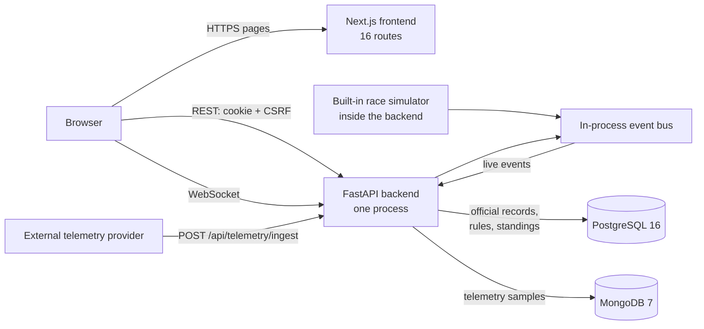

# ApexGrid architecture

This document explains what ApexGrid is for, who uses it, and how it works end to end. Setup instructions are in the [README](README.md). Detailed API payloads are in [docs/contracts.md](docs/contracts.md) and the database design in [docs/database.md](docs/database.md).

## 1. Purpose

ApexGrid runs a motorsport league: championships, circuits, teams, drivers, race events and sessions. During a race it shows live timing and car telemetry. It also handles the official decisions that follow: steward penalties, pit-lane bookings, race results and championship standings.

It is also a database systems showcase. It uses two databases, each for the work it suits:
- **PostgreSQL** is the authoritative record. Official data lives here, protected by constraints, triggers, stored functions, row locks, row-level security and an audit log.
- **MongoDB** stores high-rate telemetry samples (speed, throttle, brake, tyre data) as documents.

The `/dbms` workspace lets an administrator inspect both databases live and run real transaction, constraint and locking demonstrations.

## 2. Users and use cases

Everyone signs in. There are four roles, enforced by the backend on every request.

| Role | Can do |
|---|---|
| **Admin** | Everything: manage users and all competition records, run sessions and simulations, decide incidents, book pits, recalculate standings, use the DBMS workspace. |
| **Steward** | Run the race: start and control sessions and simulations, create live demo races, review incidents and issue penalties, book any team's pit stops. |
| **Team principal** | Follow the race and book or close pit stops for their own team only. |
| **Driver** | Read-only access to the league and live timing. |

### Main use cases

1. **Set up a season.** An admin creates a championship (with a points system), circuits, teams, drivers and dated team memberships, then race events with sessions. Each new event gets pit boxes 1–4.
2. **Run a race.** A steward starts a session and its simulator, or creates an instant generated race with 8–16 fictional cars. Cars lap the circuit sector by sector. Positions, gaps, sector times, tyre wear and pit stops stream to every open Live Timing and Pit Wall screen.
3. **Feed real telemetry.** Instead of the simulator, an external data provider posts the same normalized packets to `POST /api/telemetry/ingest`. Nothing in the interface changes.
4. **Handle incidents.** Incidents are reported during the race; generated races also raise reviewable incidents automatically. A steward approves or rejects each one. An approved penalty adds penalty points, and a PostgreSQL trigger bans a driver who reaches 12 points in a season.
5. **Manage the pit lane.** Pit stops are booked into a box and time window. Two teams can never hold the same box at overlapping times; the database enforces this under concurrent requests. In generated races the simulator plans tyre stops and allocates boxes automatically.
6. **Publish results and standings.** When a session finishes, its classification is recorded. A stored function recalculates championship standings (25-18-15-12-10-8-6-4-2-1, plus one point each for pole and fastest lap), ranked by points, then wins, then podiums.
7. **Analyse.** Analytics shows per-driver performance with championship, season, circuit, team and driver filters.
8. **Inspect the databases.** The admin-only `/dbms` workspace browses all 17 PostgreSQL tables, the EER diagram, schema, indexes, real `EXPLAIN` plans, current locks and MongoDB collections. It replays any race, live or archived, lap by lap, and runs the constraint, transaction and lock demonstrations against the real database.

## 3. System overview



| Part | Technology | Responsibility |
|---|---|---|
| Frontend | Next.js 16 (App Router), React, TypeScript | All screens. Reads REST snapshots and subscribes to a WebSocket for live updates. Holds no business rules. |
| Backend | FastAPI on Uvicorn, Python 3.12+, psycopg 3, PyMongo | Authentication and roles, validation, transaction boundaries, the race simulator, the live event bus and WebSocket delivery. |
| PostgreSQL 16 | Relational database | Users, competition data, sessions, laps, incidents, penalties, results, standings, pit boxes and reservations, audit log. Business rules run as constraints, triggers and functions. |
| MongoDB 7+ | Document database | The `telemetry` collection: one document per car sample, keyed by session and driver UUIDs. |

The two databases share no foreign keys. They are linked by UUID strings: every telemetry document carries the PostgreSQL `session_id` and `driver_id` it belongs to.

## 4. Backend

The backend is a single FastAPI application in `backend/app/`.

| Area | Main modules | What it does |
|---|---|---|
| Start-up | `bootstrap.py`, `migrations.py`, `core/lifespan.py` | `python -m app.bootstrap` applies the SQL migrations in `backend/migrations/` in order and seeds demo data. Both steps are idempotent. On start-up the app connects to both databases, takes the runtime lease, and resumes or starts generated races. |
| Auth | `auth_router.py`, `auth_cookie.py`, `core/request_auth.py`, `login_limiter.py`, `token_revocation.py` | Password login with bcrypt hashes and a rate limiter. It issues a JWT in an HTTP-only cookie plus a CSRF token for browser writes; API clients may send a Bearer token. Logout revokes the token server-side. |
| Competition records | `api/crud.py`, `crud_repository.py`, `membership_*`, `user_*` | Create, read, update and delete for championships, circuits, teams, drivers, events, sessions, memberships and users. Deleting a record that is still referenced returns 409. |
| Session lifecycle | `session_lifecycle.py`, `api/session_action.py` | `start`, `pause`, `resume`, `finish` and `reset` actions. PostgreSQL rejects illegal state transitions and timestamps. |
| Simulation | `simulation_*.py`, `core/simulation_*.py`, `demo_race_*` | An asynchronous simulator per active race. Each tick advances every car one sector according to its pace. It writes telemetry and laps, schedules tyre stops and pit boxes, raises incidents and finishes the race at its lap limit. After a restart it resumes from the last recorded state. |
| Telemetry | `telemetry_router.py`, `telemetry_repository.py` | Ingest and reads. Packets for one car must arrive in order: an exact retry returns the original ID, and an older or conflicting packet is rejected with 409. |
| Live delivery | `core/events.py`, `api/live.py`, `core/websocket_runtime.py` | An in-process publish/subscribe bus. `WS /api/ws/sessions/{id}` authenticates with the `apexgrid.jwt` subprotocol or the session cookie, checks the origin, then forwards events: session state, timing, telemetry, pit and incident updates. |
| Stewarding | `api/stewards.py`, `api/stewarding_reads.py` | Incident reports and atomic approve/reject decisions. Each decision returns the driver's updated points and eligibility. |
| Pit lane | `pit_*.py`, `api/pit_write.py` | Manual bookings, automatic earliest-free allocation, closing bookings and the strategy view (tyre age and wear, recommended stop window, assigned box). |
| Results and standings | `api/results_*.py`, `analytics_*` | Records classifications, calls the standings routine and serves analytics. |
| DBMS workspace | `api/dbms_*.py`, `core/lock_demo.py`, `core/showcase_*` | Admin-only database inspection and demonstrations. |
| Runtime safety | `runtime_lease.py`, `security_headers.py`, `core/observability.py` | Single-owner lease, security headers and request logging. |

### One backend per database

Simulators and the event bus live in memory, so exactly one backend process may serve a given PostgreSQL database. At start-up the backend takes a PostgreSQL advisory lock, the runtime lease.
- **A second backend:** another backend on the same database fails to start.
- **Lease lost:** if the lease connection drops, HTTP requests return 503, WebSockets close and simulators stop until the backend is restarted.
- **Scaling:** running more workers or replicas would need shared simulation leadership and an external message broker. That is a deliberate limit of the current design.

## 5. Data

### PostgreSQL: the official record

| Group | Tables |
|---|---|
| People | `users`, `drivers`, `teams`, `team_memberships` |
| Competition | `championships`, `points_systems` / positions, `circuits`, `race_events`, `race_sessions` |
| Race operations | `laps`, `incident_reports`, `penalties`, `penalty_points`, `session_results`, `driver_standings`, `pit_boxes`, `pit_reservations` |
| Generated races | `demo_races`, `demo_race_entries` (mark which records a generated race owns, so deleting it never touches seeded data) |
| Governance | `audit_log`, revoked tokens |

Rules the database itself enforces:
- **Integrity:** primary and foreign keys, unique driver licences and event rounds, one result per driver per session, one classified driver per position, non-negative counters, and laps between 0 and 72.
- **Team memberships:** a driver's memberships cannot overlap in time.
- **Pit bookings:** an exclusion constraint stops two active bookings for the same box from overlapping. A partial unique index allows only one open stop per driver per session.
- **Session lifecycle:** a constraint keeps session state and timestamps consistent.
- **Penalties:** inserting an official penalty fires a trigger that adds the driver's seasonal penalty points and sets them `RACE_BANNED` at 12. Penalty rows are immutable: updates and deletes are rejected.
- **Standings:** `recalculate_standings(championship_id)` walks results with an explicit cursor, applies the points system and upserts ranked totals. A concurrency guard serialises simultaneous recalculations.
- **Least privilege:** the roles `apexgrid_app` and `apexgrid_readonly` limit what each kind of access can do. Row-level security scopes the audit log by role.

Migrations live in `backend/migrations/` (001–010) and are safe to rerun. [docs/database.md](docs/database.md) covers normal forms, indexes and backup and restore.

### MongoDB: telemetry

The `telemetry` collection holds one document per car sample:
- **Fields:** session, driver, timestamp, lap and sector, elapsed and lap times, position, speed, throttle, brake, tyre compound, age, wear and temperatures, and pit state.
- **Index:** a compound index on `(session_id, driver_id, recorded time)` serves driver timelines.
- **Lifecycle:** completed races keep their telemetry as an archive. Deleting a generated race removes its documents.

## 6. How the main flows work

### Signing in
1. The login page posts the email and password. The backend checks the bcrypt hash, applies the rate limit and sets an HTTP-only session cookie and a CSRF token.
2. Later requests send the cookie automatically. Every write also sends the CSRF header, and the backend checks it with the request origin against `CORS_ORIGINS`.
3. The browser and API must share a host name (`localhost`), or the cookie is not sent.

### A live race
1. A steward clicks **Create live race**. In one transaction the backend creates an event, an active session, pit boxes, fictional drivers, teams and memberships, then starts that race's simulator.
2. On each tick the simulator moves every car forward, writes a telemetry document to MongoDB, writes completed laps to PostgreSQL, and publishes `timing.update` and `telemetry.sample` events on the bus.
3. Live Timing first loads a REST snapshot (`GET /api/sessions/{id}/live`), then opens the WebSocket and applies events as they arrive. After a disconnect it reconnects and reloads the snapshot, so it never shows a gap.
4. When a car's tyres reach their target age, the simulator books the earliest free pit box and marks the car `IN_PIT`. It then changes the tyres and publishes a `pit.update`.
5. At the lap limit the race finishes and the classification is stored. With `AUTO_DEMO_RACE=1`, a new race starts five seconds later, and finished races stay in the archive.

### A steward decision
1. A steward opens an incident and approves it with penalty points.
2. In one transaction the backend inserts the penalty, and the trigger updates `penalty_points` and eligibility.
3. The response returns the driver's new total and status, and an `incident.update` is broadcast.

### A pit booking under contention
1. Two principals request the same box for overlapping windows at the same moment.
2. Each transaction locks the box row with `SELECT … FOR UPDATE`, rechecks for overlaps and inserts.
3. The second request waits for the first and is then rejected (exclusion violation `23P01`), so one booking wins cleanly. The `/dbms` lock demonstration shows this live.

### Results and standings
1. Finishing a session and recording results writes `session_results`.
2. **Recalculate** calls `recalculate_standings`, which stores ranked rows in `driver_standings`.
3. The Standings page reads them. Rows are marked *provisional* when a historical time or grid penalty has not yet been applied to the order.

## 7. Frontend

`frontend/` is a Next.js 16 App Router application.

| Area | Location |
|---|---|
| Routes | `app/`: `/`, `/login`, `/dashboard`, `/live`, `/sessions`, `/stewards`, `/pit-wall`, `/championships`, `/events`, `/circuits`, `/standings`, `/teams`, `/drivers`, `/users`, `/analytics`, `/dbms` |
| Screens | `components/pages/`, `components/dbms-*.tsx`, `components/race-database.tsx` |
| Design system | `components/nb/` (tables, inputs, dialogs, marquee) and `app/styles/` |
| Data and live state | `lib/` hooks: `use-live-timing-state`, `use-pit-wall`, `use-steward-desk` and others, plus `lib/live-stream.ts` (WebSocket client) and `lib/api.ts` (REST client) |

Design rules:
- **Data states:** every data view renders five states (empty, loading, populated, error and partial). A failed refresh keeps the last good data on screen and offers a retry.
- **Neo-brutalist visual system:** cream, paper, ink, yellow and red tokens with hard shadows, and spacing on a fixed 4–64 px scale.
- **Touch targets:** every target is at least 44 × 44 px.
- **Motion:** animation uses only transform and opacity and respects reduced-motion preferences.
- **Permissions:** the interface hides actions the signed-in role cannot perform, but the backend enforces every permission regardless.

## 8. Security

- Passwords are stored as bcrypt hashes and never returned by the API. The table browser hides them as well.
- The session JWT lives in an HTTP-only cookie, never in browser storage. Writes need a matching CSRF token from an allowed origin.
- Revoked tokens are rejected, including on WebSockets.
- Outside `APP_ENV=local`, the backend refuses to start without a unique JWT secret of at least 32 bytes.
- Security headers (CSP, frame and referrer policies) are set on every response.
- DBMS endpoints are admin-only. Table names are whitelisted, and every query is parameterised.
- The demo accounts and the local JWT fallback are for local use only.

## 9. Deployment and operations

| Mode | How |
|---|---|
| Docker | `compose.yaml` runs PostgreSQL, MongoDB, the backend (`python -m app.bootstrap` then Uvicorn on 8000) and the frontend (`next start` on 3000). Data lives in named volumes. |
| Without Docker | The same four processes run natively; see the README. Tested on macOS, Windows 11 (x64 and ARM64) and Linux. |
| Health | `GET /health/live` reports that the process is running. `GET /health/ready` reports PostgreSQL, MongoDB and runtime-lease status. |
| Configuration | Environment variables: `DATABASE_URL`, `MONGODB_URL`, `JWT_SECRET`, `APP_ENV`, `AUTO_DEMO_RACE`, `SEED_DEMO_DATA`, `CORS_ORIGINS` and `NEXT_PUBLIC_API_URL` (fixed at frontend build time). |

## 10. Quality and testing

- **Backend:** a pytest suite runs against disposable databases (`scripts/eval/test-stack.sh`) with a coverage floor of 80%. `scripts/acceptance.py` exercises the API, WebSocket, trigger, lock conflict, telemetry and standings end to end.
- **Frontend:**
  - TypeScript type checks, lint and a production build.
  - Playwright browser tests at five viewport sizes.
  - Visual regression baselines.
  - Journeys against a real running stack.
- **CI:** GitHub Actions runs the main gates in `.github/workflows/ci.yml`. `setup-guide-windows.yml` follows the no-Docker Windows setup on an x64 runner and checks sign-in and live telemetry.

## 11. Repository layout

```
backend/
  app/            FastAPI application (modules described in section 4)
  migrations/     PostgreSQL schema, triggers, functions, roles (001–010)
  db/             demo seed data
  tests/          pytest suite
frontend/
  app/            routes and global styles
  components/     screens and the design system
  lib/            data hooks, REST and WebSocket clients
  e2e/            Playwright tests
docs/             contracts, database design, plans
scripts/          evaluation, acceptance and agent tooling
compose.yaml      Docker stack
```

Recorded design decisions are in `.agent/adr/`.
